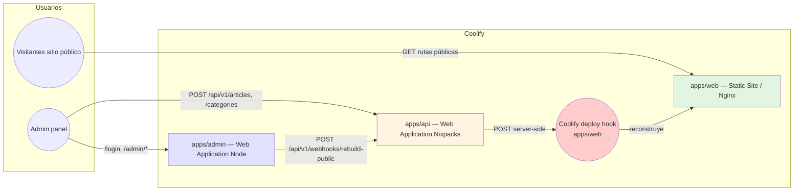

# Design

## Context

- **Estado actual:** `apps/web` contiene tanto el sitio público (SSG) como el panel de administración, el login y dependencias de admin (Firebase, Tiptap, shadcn/ui, React islands). Se despliega como un único artefacto estático en Hostinger.
- **Arquitectura existente:** API NestJS en `apps/api` con prefijo `/api/v1`, Firebase Auth/Firestore, Supabase, `ThrottlerGuard` global, CORS vía `CORS_ORIGIN`, y endpoints ya implementados de artículos y categorías protegidos con `AuthGuard`/`RolesGuard` y token Bearer.
- **Restricciones del change:** no modificar la lógica de negocio de artículos/categorías; no implementar biblioteca de medios; no convertir el blog público a SSR; la API solo añade un endpoint de webhook protegido.
- **Soporte:** OpenSpec 1.15 instalado; `pnpm workspaces` con `apps/*` y `packages/*`; Astro ^7 en `apps/web`.

## Goals / Non-Goals

**Goals:**

- `apps/admin` como aplicación Astro independiente con `output: 'server'` y adaptador `@astrojs/node` (`standalone`).
- `apps/web` limpio: solo sitio público, `output: 'static'`, sin adaptador ni código de admin.
- Las tres aplicaciones desplegables por separado en Coolify (Static Site, Web Application Node, Web Application Nixpacks).
- Endpoint `POST /api/v1/webhooks/rebuild-public` protegido (token de usuario admin o `X-Rebuild-Token`) que dispara el webhook de Coolify; la mutación de contenido nunca se revierte si el webhook falla.
- Migrar rutas y componentes de admin desde `apps/web` a `apps/admin` sin alterar el comportamiento del sitio público.
- Actualizar guardarraíles de pruebas estructurales para la nueva distribución.

**Non-Goals:**

- Cambiar DTOs, servicios, repositorios ni entidades de artículos/categorías.
- Implementar biblioteca de medios ni subida de imágenes.
- Nuevo sistema de autenticación ni nuevos roles; se reutilizan Firebase Auth y los roles existentes.
- Revalidación automática a nivel de API (se deja como decisión explícita: el panel admin solicita la revalidación tras guardar; véase Decisión 4).
- Convertir el blog público a SSR.

## Decisions

### 1. Aplicaciones separadas dentro del monorepo

**Decisión:** crear `apps/admin` como un paquete pnpm independiente con su propio `package.json`, `astro.config.mjs`, `tsconfig.json`, `src/`, `vitest.config.ts` y `playwright.config.ts`. Mantener `apps/web` y `apps/api` intactos salvo los cambios previstos.

**Rationale:** cada app tiene modo de salida diferente (`static` vs `server`), dependencias distintas y ciclos de despliegue independientes. Un paquete por app respeta `pnpm workspaces` y permite `pnpm -F @webastro/admin build` sin construir todo el monorepo.

**Alternativa considerada:** módulo único con entrada condicional (rechazado: mezclaría modos de salida y dependencias).

### 2. Migración de código del panel desde `apps/web` a `apps/admin`

**Decisión:** mover los siguientes elementos a `apps/admin`:

- `src/pages/admin/`, `src/pages/login/`
- `src/components/admin/` (incluido `tiptap/`)
- `src/components/auth/` (LoginForm y relacionados)
- `src/components/ui/` (shadcn/ui: badge, button, card, input, label, separator, table)
- `src/layouts/AdminLayout.astro`
- `src/lib/auth-headers.ts`, `src/lib/tiptap.ts`, `src/lib/utils.ts`
- `src/styles/global.css` (tokens compartidos con el diseño)

**Reconstrucción de AdminLayout:** en `apps/admin` el `AdminLayout` se vuelve autónomo (sin envolver `MainLayout`) para evitar arrastrar chrome del sitio público (Header, Footer, GTM, Turnstile, config de empresa). Reutiliza los tokens del tema pero inyecta su propio `<Head>` mínimo y el script de toggle del sidebar.

**Equivalentes de imports:** se actualizan `@/lib/api-client`, `@/lib/firebase`, `@/lib/auth-headers`, `@/lib/utils`, `@/components/*` dentro de `apps/admin`; `@webastro/shared-types` se conserva.

**Alternativa considerada:** reutilizar `MainLayout` en admin (rechazado: mezcla contenido del sitio público con el panel y obliga al panel a depender de `company.config.ts` y scripts GTM/Turnstile).

### 3. Limpiar `apps/web`

**Decisión:** eliminar de `apps/web` todo el código migrado, ajustar `astro.config.mjs` a `output: 'static'` (sin adaptador) y retirar de `package.json` las dependencias que solo usa el admin: React, `@astrojs/react`, `@types/react`, `@types/react-dom`, Firebase, Tiptap (`@tiptap/*`), shadcn base (`class-variance-authority`, `clsx`, `tailwind-merge`, `lucide-react`, `radix-ui`, `tw-animate-css`) si no las usa el sitio público.

**Validación de compatibilidad:** `ssg-build.test.ts`, `middleware-detection.test.ts` y `hostinger-compat.test.ts` de `apps/web` deben seguir pasando (sin archivos de servidor, sin middleware, solo HTML estático).

### 4. Endpoint de revalidación de sitio público (cómo se invoca)

**Decisión:** la API **no** invoca automáticamente el webhook dentro de los servicios de artículos/categorías. El panel admin, tras una mutación exitosa (crear/actualizar/eliminar artículo o categoría), llama a `POST /api/v1/webhooks/rebuild-public`. El endpoint valida y dispara el webhook de Coolify de forma server-side; si falla Coolify, responde `502` y no revierte la mutación.

**Rationale:** respeta la restricción de no tocar la lógica de negocio y mantiene el cambio mínimo en la API.

**Alternativa considerada:** hook automático en `ArticlesService`/`CategoriesService` tras cada mutación (rechazado: cambia la lógica de negocio y acopla el contenido a una dependencia externa).

### 5. Protección del endpoint de revalidación

**Decisión:** `POST /api/v1/webhooks/rebuild-public` acepta cualquiera de los dos: (a) `Authorization: Bearer <Firebase ID token>` de rol `admin`, o (b) header `X-Rebuild-Token` igual a `REVALIDATION_WEBHOOK_TOKEN`. De lo contrario `401`. Si el usuario está autenticado pero no es `admin`, `403`.

**Rationale:** permite tanto la llamada desde el panel autenticado como disparos server-side de CI/webhooks sin cuenta de Firebase. Reutiliza `AuthGuard` y `RolesGuard` existentes para la opción (a).

### 6. Variables de entorno

- `apps/web`: solo `PUBLIC_*` en build time (API URL, Turnstile, Firebase público, GM tag).
- `apps/admin`: `PUBLIC_API_URL`, `PUBLIC_FIREBASE_*` (build-time para el bundle cliente), `PORT`, `HOST`.
- `apps/api`: `FIREBASE_PROJECT_ID/CLIENT_EMAIL/PRIVATE_KEY`, `SUPABASE_*`, `CORS_ORIGIN` (incluye dominio del panel y del público), `REVALIDATION_WEBHOOK_TOKEN`, `COOLIFY_REBUILD_WEBHOOK_URL`.

### 7. CORS

**Decisión:** `CORS_ORIGIN` se amplía con el dominio de producción del panel admin (y del sitio público). `main.ts` ya divide por comas y permite `Authorization`; solo se documenta la nueva entrada.

### 8. Despliegue en Coolify

**Decisión:**

- `apps/web`: Static Site (Nginx), directorio de publicación `apps/web/dist/`, build `pnpm --filter @webastro/web build`.
- `apps/admin`: Web Application (Node.js, standalone), start `node ./dist/server/entry.mjs`, build `pnpm --filter @webastro/admin build`.
- `apps/api`: Web Application (Nixpacks), start `node dist/main`, build `pnpm --filter @webastro/api build`.
- Webhook de rebuild: URL configurada en Coolify para `apps/web`, consumida por `apps/api` vía `COOLIFY_REBUILD_WEBHOOK_URL`.

## Architecture Diagram (mermaid)

## Risks / Trade-offs

- [Risk] `@astrojs/node` y la versión de Astro ^7 pueden requerir una versión específica del adaptador.
  → Mitigación: instalar `@astrojs/node` compatible con Astro 7 y verificar con `pnpm --filter @webastro/admin build`.
- [Risk] `PUBLIC_*` variables se inlinean en el cliente al construir; `apps/admin` necesita esas variables en su propio build.
  → Mitigación: configurar `PUBLIC_API_URL` y `PUBLIC_FIREBASE_*` como variables de build de `apps/admin` en Coolify.
- [Risk] `AdminLayout` autónomo duplica la lógica de tema (`localStorage`, `data-theme`) respecto de `MainLayout`.
  → Mitigación: reutilizar el mismo bloque de script de `Head.astro` y documentar que cambios de tema deben replicarse en ambos.
- [Risk] Los guardarraíles de `apps/web` (`admin-cleanup.test.ts`, `dependency-audit.test.ts`, `ssg-build.test.ts`) asumen la presencia/ausencia del admin y de `@astrojs/node`.
  → Mitigación: reescribir dichos tests en el cambio (ya en `tasks.md`).
- [Risk] El webhook de Coolify puede fallar o no estar configurado.
  → Mitigación: respuesta `200` con `skipped: true` sin URL y `502` con mensaje si Coolify responde mal; el contenido guardado no se revierte.
- [Risk] `sessionStorage` del blog (5 min) puede mostrar contenido viejo tras el rebuild hasta expirar.
  → Mitigación: documentado como deuda; opcional invalidar cache vía service worker en cambio posterior.

## Migration Plan

1. Crear `apps/admin` con Astro SSR + `@astrojs/node`, react, tailwind, shadcn/ui.
2. Migrar código de admin desde `apps/web` (ver Decisión 2).
3. Limpiar `apps/web` y ajustar dependencias.
4. Crear endpoint de revalidación en `apps/api` (test rojo primero, luego implementación).
5. Actualizar guardarraíles de pruebas y e2e (login se mueve a `apps/admin`).
6. Documentar despliegue en Coolify y variables de entorno.
7. Ejecutar suites de `apps/web`, `apps/admin` y `apps/api`; `openspec validate --all --strict`; rollback mediante revert de commits (sin migraciones de datos).

## Open Questions

- ¿El panel admin debe llamar al endpoint de revalidación también cuando el cambio de contenido lo hace otro cliente no administrador? (se decide no: solo desde el panel admin; futuro: hook automático si se requiere).
